# FilingIQ

An incremental, automated document-ingestion pipeline in Snowflake that
feeds a RAG (retrieval-augmented generation) chatbot answering questions
about company 10-K annual reports. Built as a **data engineering**
portfolio project — the pipeline (change detection, idempotent
processing, data-quality checks, monitoring) is the point; the chatbot is
the demo layer that proves it works.

> **Trial-account note (read this first):** this project originally
> targeted Snowflake Cortex end-to-end (`PARSE_DOCUMENT`,
> `SPLIT_TEXT_RECURSIVE_CHARACTER`, Cortex Search, `COMPLETE`). Testing
> against a real trial account (2026-11-11) showed every Cortex/AI
> function — both the legacy `SNOWFLAKE.CORTEX.*` family and the newer
> `AI_*` family — is blocked without a payment method on file:
> ```
> SNOWFLAKE.CORTEX.COMPLETE is not available on this account. New accounts
> are blocked from using legacy SNOWFLAKE.CORTEX functions. Please migrate
> to AI Functions and use AI_COMPLETE instead.
> AI function _AI_PARSE_DOCUMENT is not available for trial accounts.
> AI function EMBED_TEXT_768 is not available for trial accounts.
> ```
> The architecture below reflects the **re-architected, no-payment-method
> version actually running on a trial account**: PDF parsing and chunking
> are Snowflake Python UDFs, retrieval is a SQL TF-IDF table function, and
> answer generation runs on Groq's free tier from a local app/notebook
> (since Streamlit in Snowflake / Snowflake Notebooks can't make arbitrary
> outbound calls to Groq without extra network setup). If your account
> *does* have AI Functions enabled, every Cortex-shaped swap-in point is
> called out below and in the relevant SQL file's header comment.

## Problem statement

Reading 10-Ks across many companies and years to answer a specific
question ("what was X's data-center revenue growth from FY23 to FY24?")
is slow and error-prone. FilingIQ automates the unglamorous but critical
part of that workflow — getting new filings parsed, chunked, deduplicated,
indexed, and monitored the moment they're uploaded, with no manual
re-running or risk of duplicate/stale data — so a chatbot (or any
downstream consumer) always has a clean, up-to-date, filterable corpus to
query.

## Architecture

```mermaid
flowchart LR
    A[Analyst uploads<br/>TICKER_YEAR_10K.pdf] --> B[RAW_DOCS internal stage<br/>directory table enabled]
    B -->|ALTER STAGE REFRESH| C[DOCS_STREAM<br/>CDC on directory table]
    C -->|WHEN SYSTEM$STREAM_HAS_DATA| D[INGEST_TASK<br/>hourly schedule]
    D --> E[PROCESS_NEW_DOCS&#40;&#41;<br/>stored procedure]
    E -->|PDF_TO_TEXT Python UDF| F[PARSED_DOCS]
    F -->|CHUNK_TEXT Python UDF<br/>+ SHA2 dedup| G[DOC_CHUNKS]
    E -->|per-file status| H[INGESTION_LOG]
    G --> I[SEARCH_CHUNKS<br/>TF-IDF SQL UDTF]
    I --> J[Local Streamlit app]
    J -->|Groq, grounded prompt| K[Answer + cited sources]
    H --> L[Pipeline status tab]
    G -. 3 chunk configs .-> M[Local Jupyter notebook<br/>TruLens evaluation]
```



## Tech stack

| Layer | Technology |
|---|---|
| Storage / CDC | Snowflake internal stage (directory table) + STREAM |
| Orchestration | Snowflake TASK (serverless-scheduled, conditional on stream state) |
| Processing | Snowflake Scripting stored procedure |
| Document parsing | `PDF_TO_TEXT` — Snowflake Python UDF (`pypdf`); swap-in point for `SNOWFLAKE.CORTEX.PARSE_DOCUMENT` if your account has AI Functions |
| Chunking | `CHUNK_TEXT` — Snowflake Python UDF (hand-rolled recursive-character splitter); swap-in point for `SNOWFLAKE.CORTEX.SPLIT_TEXT_RECURSIVE_CHARACTER` |
| Retrieval | `SEARCH_CHUNKS` — SQL table function, TF-IDF keyword search over `DOC_CHUNKS`; swap-in point for a Cortex Search Service |
| Generation | Groq free tier (`openai/gpt-oss-120b` / `openai/gpt-oss-20b`); swap-in point for `SNOWFLAKE.CORTEX.COMPLETE` |
| App | Local Streamlit app, `snowflake-connector-python` + `requests` |
| Evaluation | Local Jupyter notebook + TruLens (Snowflake connector for persistence, LiteLLM/Groq provider for scoring), LLM-as-judge |
| Compute | Single X-Small warehouse, auto-suspend 60s |

## Folder structure

```
filingiq/
  sql/
    01_setup.sql              database, warehouse, stage, core tables
    02_stream.sql              CDC stream on the stage
    03_process_procedure.sql   PDF_TO_TEXT / CHUNK_TEXT UDFs + PROCESS_NEW_DOCS() procedure
    04_task.sql                hourly task + incremental-load test queries
    05_search_service.sql      SEARCH_CHUNKS TF-IDF table function + tests
    99_teardown.sql            drop everything
  app/
    streamlit_app.py           chat UI + pipeline status dashboard (local app)
    requirements.txt            pip dependencies
    .env.example                Snowflake + Groq credentials template
  eval/
    eval_notebook.ipynb         3-config chunking evaluation (local, TruLens)
    questions.csv               30-question eval set (fill in expected_answer)
    QUESTION_GUIDE.md           how to write good eval questions
    requirements.txt            pip dependencies
    .env.example                Snowflake + Groq credentials template
    results/                    eval output (CSVs, chart) lands here
  docs/
    INTERVIEW_NOTES.md
    DEMO_SCRIPT.md
    RESUME.md
    screenshots/
  README.md
  RUNBOOK.md
```

## Setup

1. Create a Snowflake trial account (any Snowsight-supported region; this
   version doesn't depend on Cortex region availability since it doesn't
   use Cortex).
2. Open a Snowsight SQL worksheet and run `sql/01_setup.sql` through
   `sql/05_search_service.sql` in order (see `RUNBOOK.md` for exact
   expected output at each step).
3. Download 10-K PDFs from each company's investor-relations site,
   rename them to `TICKER_YEAR_10K.pdf`, and upload them to the
   `RAW_DOCS` stage via Snowsight.
4. Get a free Groq API key (no payment method required):
   [console.groq.com/keys](https://console.groq.com/keys).
5. `cd app/`, `pip install -r requirements.txt`, `cp .env.example .env`
   and fill it in, then `streamlit run streamlit_app.py`.
6. `cd eval/`, fill in `expected_answer` in `questions.csv`, `pip install
   -r requirements.txt`, `cp .env.example .env` and fill it in, then run
   `eval_notebook.ipynb` end to end with Jupyter.

## Pipeline design decisions

- **Idempotency.** Re-uploading a file (same `TICKER_YEAR_10K.pdf` name)
  never creates duplicate chunks: `PROCESS_NEW_DOCS()` deletes any
  existing `PARSED_DOCS`/`DOC_CHUNKS` rows for a path *before*
  reprocessing it, so a replace is a true replace, not an append. Chunk
  identity is further protected by a `SHA2(chunk)` hash dedup within each
  file, which also catches accidental exact-duplicate boilerplate
  (repeated headers/footers) a PDF parser can emit.
- **Incremental processing.** A `STREAM ON STAGE` plus `TASK ... WHEN
  SYSTEM$STREAM_HAS_DATA(...)` means the pipeline only does work (and
  only spins up the warehouse) when there are genuinely new or changed
  files — uploading a batch of files and then a few more only ever
  reprocesses the new ones, verified directly against `INGESTION_LOG`
  (see `sql/04_task.sql`).
- **Per-file error isolation.** Each file is parsed/chunked inside its own
  nested `BEGIN...EXCEPTION...END` block in Snowflake Scripting, so one
  malformed or image-only PDF can't fail the entire hourly batch — it's
  logged as `FAILED` and the rest proceed.
- **Data-quality checks baked into the log.** `FAILED` (empty parsed
  text or a parsing error), `WARN` (fewer than 5 chunks — likely a mostly
  image-based filing that `PDF_TO_TEXT` under-extracted), `OK` otherwise.
  This turns "did ingestion work?" into a one-query answer instead of a
  log-scraping exercise.
- **Cost-aware by default.** One X-Small warehouse, 60-second
  auto-suspend, an hourly (not continuous) task schedule gated on
  `SYSTEM$STREAM_HAS_DATA` — no compute is spent checking for work that
  isn't there. `SEARCH_CHUNKS` queries `DOC_CHUNKS` directly on each call
  (no separate index object to keep warm or re-sync), so there's no
  indexing cost at all beyond the query itself.
- **Re-architecting around a real platform constraint.** The pivot from
  Cortex to Python UDFs + TF-IDF + Groq, documented above and in each
  affected SQL file's header comment, is itself a design decision worth
  being able to explain: a production pipeline has to work within the
  account/budget it's actually given, not the one a tutorial assumes.

## Evaluation results

Run live on 2026-11-12 (production config, 1800/300 chunking, 30
questions against the real 8-company/12-filing corpus). Only one config
was run — see "Future improvements" for why — so this isn't a 3-way
comparison, it's a direct quality measurement of what's actually deployed.

| Metric | Score | Sample |
|---|---|---|
| Groundedness | 0.64 | 11 questions |
| Context relevance | 0.81 | 12 questions |
| Answer relevance | 0.75 | 12 questions |
| Accuracy (LLM-judge vs. human-written expected answers) | 0.33 | 12 questions |
| Refusal rate (unanswerable questions) | **not measured** | 0 of 6 |

**Why the sample sizes are 11-12 instead of 30, and refusal rate is
missing entirely:** Groq's free tier rate-limits aggressively (an
~8,000 tokens/minute cap that this notebook's call volume — up to 4 Groq
calls per question — burns through fast), and this project's key hit that
limit partway through the run. The 6 unanswerable-question rows happened
to be later in `questions.csv` and all failed before getting a real
answer, so refusal rate has zero valid data points, not a real `0%` —
reporting a `0%` here would misleadingly suggest the model never
refuses, when actually it was simply never asked (successfully). The
other four metrics *are* real measurements from the questions that did
complete, just on a partial sample.

**To get the complete picture:** re-run `eval/eval_notebook.ipynb` with a
fresh Groq key (or after your existing key's quota resets) — the per-row
pacing and retry logic are already tuned to survive a full 30-question
run as long as the underlying quota holds out. The three chunk-size
configs (1000/200, 3000/500) can also be re-enabled in the notebook's
`CONFIGS` dict for an actual 3-way comparison once quota allows a longer
run.

## Screenshots

*(Add screenshots after deploying; placeholders below.)*

- `docs/screenshots/chat_tab.png` — chat tab with a grounded answer + cited sources
- `docs/screenshots/pipeline_status_tab.png` — pipeline status dashboard
- `docs/screenshots/ingestion_log.png` — INGESTION_LOG after an incremental run
- `docs/screenshots/eval_chart.png` — chunking configuration comparison chart

## Cost notes

- Everything in Snowflake runs on a single X-Small warehouse with
  `AUTO_SUSPEND = 60`; it is only ever billed while a query/task is
  actively running.
- The hourly task is gated by `WHEN SYSTEM$STREAM_HAS_DATA(...)`, which is
  evaluated for free (no warehouse spin-up) when there's nothing new to
  process — most hours cost nothing.
- `SEARCH_CHUNKS` has no standing index to maintain (unlike a Cortex
  Search Service's `TARGET_LAG`-driven re-embedding), so retrieval cost
  is just the warehouse time of the query itself.
- Groq's free tier has no payment method and a generous but real rate
  limit; the eval notebook paces requests and retries once on HTTP 429
  (see `eval/eval_notebook.ipynb` section 4) to stay under it across 30
  questions x 3 configs.
- On a free Snowflake trial account, watch remaining trial credits in the
  Snowsight billing page even though this version avoids metered AI
  Functions — Python UDF execution and warehouse compute still consume
  credits.

## Trial-account notes / things that needed the closest alternative

This is the authoritative list of every place this project deviates from
a "full Cortex" design because of trial-account restrictions, and what
it does instead:

| Cortex feature | Blocked because | Alternative used here |
|---|---|---|
| `SNOWFLAKE.CORTEX.PARSE_DOCUMENT` / `AI_PARSE_DOCUMENT` | Not available for trial accounts | `PDF_TO_TEXT` Python UDF (`pypdf`) — `sql/03_process_procedure.sql` |
| `SNOWFLAKE.CORTEX.SPLIT_TEXT_RECURSIVE_CHARACTER` | Same Cortex restriction | `CHUNK_TEXT` Python UDF (hand-rolled recursive splitter) — `sql/03_process_procedure.sql` |
| Cortex Search Service | Calls `EMBED_TEXT_768` internally, blocked for trial accounts | `SEARCH_CHUNKS` SQL table function, TF-IDF keyword scoring — `sql/05_search_service.sql` |
| `SNOWFLAKE.CORTEX.COMPLETE` / `AI_COMPLETE` | Legacy functions blocked; AI Functions require a payment method | Groq free-tier API, called from the local app/notebook — `app/streamlit_app.py`, `eval/eval_notebook.ipynb` |
| Streamlit in Snowflake / Snowflake Notebooks | Sandboxed runtime can't make arbitrary outbound calls to Groq without an External Access Integration | App and notebook run locally, talking to Snowflake via `snowflake-connector-python` |
| TruLens's Cortex feedback provider | Depends on `SNOWFLAKE.CORTEX.COMPLETE` | TruLens's `LiteLLM` provider pointed at Groq; TruLens's `SnowflakeConnector` is still used to persist results |

If your account has AI Functions enabled (i.e. a payment method is on
file), each row above is a drop-in swap: re-point `PDF_TO_TEXT`/
`CHUNK_TEXT` calls in `sql/03_process_procedure.sql` to
`AI_PARSE_DOCUMENT`/a Cortex splitter, recreate `sql/05_search_service.sql`
as a real Cortex Search Service, and swap Groq calls in the app/notebook
for `AI_COMPLETE`/`SNOWFLAKE.CORTEX.COMPLETE` (at which point the app
could move back into Streamlit in Snowflake, too).

Separately: several function/syntax choices are marked `-- VERIFY` inline
because Groq's model catalog and TruLens's package layout both change
fairly often — re-check against current docs before relying on this in
production.

## Future improvements

- Wrap the RAG pipeline in a full TruLens `App`/`TruCustomApp` recorder
  (vs. this project's direct feedback-function scoring) for continuous,
  trace-level production monitoring, not just one-off config comparison.
- Add a `SYSTEM$SEND_EMAIL`-triggered alerting task fired on a `FAILED`
  row in `INGESTION_LOG`, instead of relying on someone checking the
  Streamlit dashboard.
- Support multi-file-type ingestion (10-Q, 8-K, earnings-call transcripts)
  by generalizing the filename-convention parser into a small lookup/
  config table instead of hardcoded `SPLIT_PART` logic.
- If/when AI Functions become available on the account, migrate
  `SEARCH_CHUNKS`'s TF-IDF scoring to real embedding-based (semantic)
  search — the biggest retrieval-quality gap in the current design is
  that TF-IDF can't match a synonym or a differently-worded question to
  the right chunk.
- Add row-level access policies on `DOC_CHUNKS` if this were ever
  multi-tenant (e.g. restricting which companies a given role can query).
- Re-point `SEARCH_CHUNKS`/the production `DOC_CHUNKS` table at whichever
  chunk configuration the evaluation notebook recommends, and
  parameterize `PROCESS_NEW_DOCS()`'s defaults to match.
